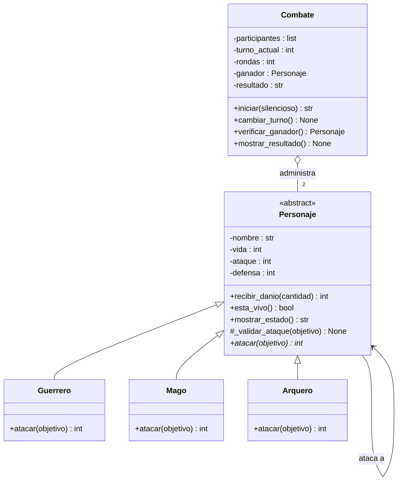

# Guardians of the Ancient Kingdom

Sistema de combate por turnos en Python para la asignatura **Programación Orientada a Objetos con Python** (Proyecto integrador / Parcial II).

---

## 1. Descripción

En el reino de Eldoria existen tres órdenes de guardianes: Guerreros, Magos y Arqueros. Todos tienen nombre, vida, ataque y defensa, pero cada orden pelea de forma distinta. Este programa enfrenta a dos guardianes por turnos, aplica las reglas de daño de cada uno, actualiza la vida y decide solo quién gana (o si hay empate).

El problema que resuelve es modelar personajes que comparten características pero se comportan diferente, y un "árbitro" que dirige el combate sin necesidad de conocer los detalles de cada personaje.

## 2. Estructura

```text
Guardians-of-the-Ancient-Kingdom/
├── personajes.py        # Definición de todas las clases (no ejecuta nada al importarse)
├── main.py              # Creación de objetos, combates y casos de prueba obligatorios
├── test_personajes.py   # Pruebas automatizadas con Pytest (Reto 2)
└── README.md            # Documentación
```

- **`personajes.py`**: contiene `Personaje` (abstracta), `Guerrero`, `Mago`, `Arquero`, `Combate` y la excepción `AtaqueInvalidoError`.
- **`main.py`**: importa las clases, crea personajes, ejecuta combates y muestra los 12 casos de prueba obligatorios con su resultado (`OK` / `FALLO`).
- **`test_personajes.py`**: las mismas reglas verificadas de forma automática y repetible con Pytest.

## 3. Clases

| Clase | Responsabilidad |
|---|---|
| `Personaje` (abstracta) | Guarda y protege nombre, vida, ataque y defensa; valida los datos; implementa `recibir_danio()`, `esta_vivo()`, `mostrar_estado()` y las validaciones comunes de un ataque; declara `atacar()` como abstracto. |
| `Guerrero` | Implementa `atacar()` con *Golpe poderoso*: `max(0, ataque × 1.20 − defensa)`, redondeando hacia abajo. |
| `Mago` | Implementa `atacar()` con *Hechizo penetrante*: el daño es igual a su ataque e ignora la defensa. |
| `Arquero` | Implementa `atacar()` con *Disparo crítico*: si `ataque > defensa`, daño `(ataque − defensa) × 2`; si no, 0. |
| `Combate` | Recibe dos personajes ya creados, controla turnos y rondas, detecta al ganador y los empates, y muestra el resultado. |

## 4. Relaciones

- **Herencia** (`Guerrero`, `Mago`, `Arquero` → `Personaje`): un Guerrero *es un* Personaje. Se usó para no repetir nombre, vida, ataque, defensa ni los métodos comunes en tres clases.
- **Asociación** (`Personaje` ↔ `Personaje`): al atacar, un personaje usa a otro mediante sus métodos (`atacante.atacar(objetivo)` llama a `objetivo.recibir_danio()`). Ninguno *contiene* al otro, solo interactúan.
- **Agregación** (`Combate` ◇— `Personaje`): un combate *tiene* dos participantes, pero estos se crean fuera de él y siguen existiendo cuando el combate termina. Por eso `Combate` los recibe por el constructor.

## 5. Conceptos de POO en el programa

- **Abstracción:** `Personaje` hereda de `ABC` y su método `atacar()` está marcado con `@abstractmethod`. No se puede crear un "personaje genérico" (`Personaje(...)` lanza `TypeError`); solo tipos concretos.
- **Encapsulamiento:** los atributos son privados (`__nombre`, `__vida`, `__ataque`, `__defensa`) y se acceden con `@property` y setters que validan. Por ejemplo, `vida` solo acepta enteros entre 0 y 100, y `recibir_danio()` nunca deja la vida por debajo de 0. Las subclases usan los getters, no tocan los atributos privados.
- **Herencia:** las tres subclases reciben constructor, propiedades, `recibir_danio()`, `esta_vivo()`, `mostrar_estado()` y `_validar_ataque()` desde `Personaje`.
- **Polimorfismo:** en `Combate.iniciar()` se ejecuta `atacante.atacar(defensor)` sin preguntar si es Guerrero, Mago o Arquero; cada objeto ejecuta su propia versión. Un cuarto tipo de guardián funcionaría sin modificar `Combate`.

## 6. Lógica del combate

**Cálculo del daño** (cada subclase lo hace en `atacar()`, y luego llama a `objetivo.recibir_danio(daño)`, que devuelve el daño efectivamente recibido):

| Personaje | Fórmula |
|---|---|
| Guerrero | `max(0, ataque × 1.20 − defensa)` con `ataque × 120 // 100` (enteros, redondeo hacia abajo) |
| Mago | `ataque` |
| Arquero | `(ataque − defensa) × 2` si `ataque > defensa`, de lo contrario `0` |

**Turnos:**

1. El primer personaje que se pasó al constructor ataca primero.
2. Una ronda = un ataque de cada uno. `cambiar_turno()` alterna al atacante.
3. Tras cada ataque se muestra el estado de ambos y se llama a `verificar_ganador()`: si alguien llegó a 0 de vida, el otro gana y el combate termina (el derrotado no vuelve a atacar).
4. Si en una ronda completa nadie recibió daño: **empate técnico**.
5. Si se completan 50 rondas sin ganador: **empate**.

Ejemplo del enunciado (Arthas vs Gandalf): daños `26, 40, 26, 40, 26, 20` (el último es "20 efectivo": Gandalf pega 40 pero Arthas solo tenía 20 de vida). Gana Gandalf con 2 de vida.

## 7. Ejecución

Requiere Python 3.8 o superior (el programa no usa librerías externas).

```bash
git clone https://github.com/<usuario>/Guardians-of-the-Ancient-Kingdom.git
cd Guardians-of-the-Ancient-Kingdom
python main.py
```

Para las pruebas automatizadas:

```bash
pip install pytest
python -m pytest -v
```

## 8. Pruebas (casos obligatorios)

`python main.py` ejecuta y muestra cada caso. Resultado final: **27 de 27 comprobaciones superadas**.

| # | Caso | Resultado |
|---|---|---|
| 1 | Creación de Guerrero, Mago y Arquero | Correcto |
| 2 | Vida 150, 101 y −5 | Rechazadas con `ValueError` |
| 3 | Nombre vacío, solo espacios y no texto | Rechazados (`ValueError` / `TypeError`) |
| 4 | Ataque 0, −10, texto; defensa −1, decimal | Rechazados (`ValueError` / `TypeError`) |
| 5 | Guerrero (30 vs defensa 10) | Daño 26 |
| 6 | Mago (40 vs defensa 20) | Daño 40 |
| 7 | Arquero (35 vs defensa 15) | Daño 40; sin crítico si no supera la defensa → 0 |
| 8 | Vida negativa | Imposible: 50 de daño con 20 de vida → daño efectivo 20, vida 0 |
| 9 | Atacar derrotado / atacar a derrotado | `AtaqueInvalidoError` |
| 10 | Combate completo Arthas vs Gandalf | Daños `[26, 40, 26, 40, 26, 20]` |
| 11 | Ganador | Gandalf (vida 2) |
| 12 | Combate sin daño | `EMPATE_TECNICO` en 1 ronda |
| Extra | 50 rondas sin ganador | `EMPATE_RONDAS` |

---

## Reto 1 — Diagrama de clases UML

Un **diagrama de clases UML** es un plano del programa: muestra las clases, sus atributos y métodos, y cómo se relacionan (herencia, asociación, agregación). Sirve para entender y comunicar el diseño antes y después de programar. Este diagrama usa Mermaid, que GitHub dibuja automáticamente.



**Explicación:** `Personaje` es la clase abstracta (`<<abstract>>`) y `atacar()` aparece con `*` por ser abstracto. Las flechas con triángulo vacío indican herencia: las tres subclases sobrescriben `atacar()`. El rombo vacío (`o--`) es la agregación: `Combate` administra exactamente 2 personajes que existen por separado. La flecha `Personaje --> Personaje` es la asociación: al atacar, un personaje usa a otro. Los atributos con `-` son privados y los métodos con `+` son públicos.

## Reto 2 — Pruebas automatizadas con Pytest

**Pytest** es una herramienta de Python para escribir pruebas automáticas: cada función `test_...` comprueba una regla con `assert` y Pytest ejecuta todas e informa cuáles pasan o fallan. A diferencia de leer la salida de `main.py` a ojo, las pruebas son repetibles y detectan errores de inmediato si algo se rompe al modificar el código.

`test_personajes.py` verifica: creación válida, rechazo de valores incorrectos, daño de cada clase (incluido el redondeo y que nunca sea negativo), que la vida nunca sea negativa, que un derrotado no pueda atacar y que el combate determine bien el ganador y los empates.

Ejecución:

```bash
python -m pytest -v
```

Resultado:

```text
============================= test session starts ==============================
platform linux -- Python 3.12.3, pytest-9.1.1, pluggy-1.7.0 -- /usr/bin/python3
cachedir: .pytest_cache
rootdir: /home/claude/Guardians-of-the-Ancient-Kingdom
collecting ... collected 32 items

test_personajes.py::test_creacion_valida[Guerrero] PASSED                [  3%]
test_personajes.py::test_creacion_valida[Mago] PASSED                    [  6%]
test_personajes.py::test_creacion_valida[Arquero] PASSED                 [  9%]
test_personajes.py::test_personaje_es_abstracto PASSED                   [ 12%]
test_personajes.py::test_vida_fuera_de_rango[101] PASSED                 [ 15%]
test_personajes.py::test_vida_fuera_de_rango[150] PASSED                 [ 18%]
test_personajes.py::test_vida_fuera_de_rango[-1] PASSED                  [ 21%]
test_personajes.py::test_nombre_vacio[] PASSED                           [ 25%]
test_personajes.py::test_nombre_vacio[   ] PASSED                        [ 28%]
test_personajes.py::test_ataque_no_positivo[0] PASSED                    [ 31%]
test_personajes.py::test_ataque_no_positivo[-5] PASSED                   [ 34%]
test_personajes.py::test_defensa_negativa PASSED                         [ 37%]
test_personajes.py::test_tipos_invalidos[ataque-x] PASSED                [ 40%]
test_personajes.py::test_tipos_invalidos[defensa-1.5] PASSED             [ 43%]
test_personajes.py::test_tipos_invalidos[vida-True] PASSED               [ 46%]
test_personajes.py::test_dano_guerrero PASSED                            [ 50%]
test_personajes.py::test_dano_guerrero_redondea_hacia_abajo PASSED       [ 53%]
test_personajes.py::test_dano_guerrero_nunca_negativo PASSED             [ 56%]
test_personajes.py::test_dano_mago_ignora_defensa PASSED                 [ 59%]
test_personajes.py::test_dano_arquero_critico PASSED                     [ 62%]
test_personajes.py::test_arquero_sin_critico_si_no_supera_defensa PASSED [ 65%]
test_personajes.py::test_vida_nunca_negativa PASSED                      [ 68%]
test_personajes.py::test_danio_negativo_rechazado PASSED                 [ 71%]
test_personajes.py::test_recibir_danio_no_descuenta_defensa_otra_vez PASSED [ 75%]
test_personajes.py::test_derrotado_no_puede_atacar PASSED                [ 78%]
test_personajes.py::test_no_se_puede_atacar_a_derrotado PASSED           [ 81%]
test_personajes.py::test_objetivo_invalido PASSED                        [ 84%]
test_personajes.py::test_combate_arthas_vs_gandalf PASSED                [ 87%]
test_personajes.py::test_combate_empate_tecnico PASSED                   [ 90%]
test_personajes.py::test_combate_empate_por_50_rondas PASSED             [ 93%]
test_personajes.py::test_combate_rechaza_participantes_invalidos PASSED  [ 96%]
test_personajes.py::test_combate_no_se_reinicia PASSED                   [100%]

============================== 32 passed in 0.04s ==============================
```

## Reto 3 — Reto de abstracción

**¿Por qué `atacar()` debe ser abstracto, pero `recibir_danio()` puede estar implementado en la clase base?**

`Personaje` tiene la responsabilidad de representar lo que **todo** guardián es y puede hacer sin importar su orden: tener nombre, vida, ataque y defensa, estar vivo o derrotado, y *sufrir* daño. Pero un `Personaje` en sí mismo no es un guerrero, ni un mago, ni un arquero, así que no sabe *cómo* pelea. Esa es la razón de que sea abstracta.

**Por qué `atacar()` es abstracto.** Todos los personajes atacan (por eso el método existe en la base y `Combate` puede llamarlo), pero la forma de calcular el daño es diferente en cada uno: el `Guerrero` multiplica su ataque por 1.20 y resta la defensa (30 de ataque contra 10 de defensa → 26), el `Mago` ignora la defensa (40 → 40) y el `Arquero` duplica el daño si supera la defensa (35 contra 15 → 40). No existe una implementación "correcta por defecto" que sirva para los tres; si hubiera una, una subclase nueva podría olvidarse de personalizarla y pelear con una regla que no le corresponde. Al declararlo `@abstractmethod`, Python **obliga** a cada subclase a definir su propia versión y no deja instanciar `Personaje` directamente.

**Por qué `recibir_danio()` sí se implementa en la base.** Recibir daño es igual para todos: restar de la vida, sin que baje de 0, rechazar cantidades negativas y devolver el daño efectivo (si Arthas tiene 20 de vida y recibe 40, pierde 20). Esa lógica no depende de la orden del personaje, solo de su vida, que pertenece a `Personaje`. Escribirla una sola vez evita duplicar código en tres clases, y además la protege: como `__vida` es privado, solo `recibir_danio()` la modifica, y las reglas de validación están en un único lugar. Además, el daño llega ya calculado por el atacante (cada subclase en su `atacar()` aplica sus propias reglas de defensa), por eso la base no vuelve a restar la defensa.

**Relación con abstracción, herencia y polimorfismo.**
- *Abstracción:* la clase base define el "contrato" (todo personaje puede atacar y recibir daño) sin comprometerse con los detalles de cómo ataca.
- *Herencia:* lo común (`recibir_danio()`, `esta_vivo()`, atributos, validaciones) se hereda y se reutiliza; lo particular (`atacar()`) se sobrescribe.
- *Polimorfismo:* gracias a que todos cumplen el mismo contrato, `Combate` ejecuta `atacante.atacar(defensor)` sin saber de qué tipo es cada uno, y cada objeto responde con su propia versión. Si se añade un `Sacerdote`, solo hay que heredar de `Personaje` e implementar `atacar()`: `Combate` no cambia, y `recibir_danio()` ya funciona para él.
